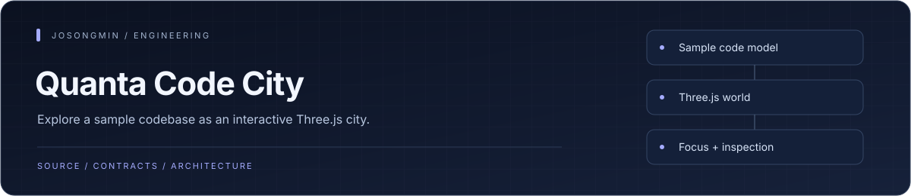
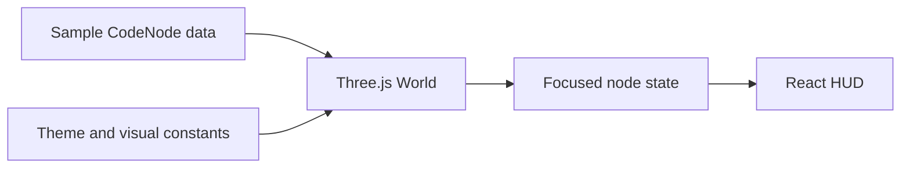

<p align="center"></p>

# Quanta Code City

<p align="center"><a href="#engineering-highlights">Engineering</a> · <a href="#architecture-at-a-glance">Architecture</a> · <a href="#run-locally">Get started</a> · <a href="#documentation">Reference</a></p>

A 3D prototype that represents source-code structure and engineering metrics as a city. A Three.js scene and React HUD connect spatial exploration to selected-node details.

## Engineering highlights

| Mechanism | Engineering purpose | Source |
| :--- | :--- | :--- |
| **Scene / inspector separation** | The world owns 3D interaction, while the HUD receives focused-node state through the application boundary. | [App boundary](src/App.tsx) |
| **Typed code-node model** | A shared model carries node identity, type, dependencies, and sample quality/risk attributes. | [Node types](src/types.ts) |
| **Inspectable visual encoding** | The scene and interface explore how size, coupling, coverage, and risk could be represented spatially. | [World](src/components/World.tsx) |

## Architecture at a glance



## What it does

- Render code nodes as spatial objects and buildings.
- Inspect the selected node through a coordinated HUD.
- Experiment with visual encodings for complexity, dependencies, coverage, and technical debt.
- Explore motion, themes, and scene-level interactions.

## Repository map

| Path | Responsibility |
| --- | --- |
| [src/components/World.tsx](src/components/World.tsx) | 3D scene and node selection. |
| [src/components/HUD.tsx](src/components/HUD.tsx) | Selected-node information. |
| [src/constants.ts](src/constants.ts) | Theme and `MOCK_NODES` demonstration data. |
| [src/types.ts](src/types.ts) | Visualization data model. |
| [src/App.tsx](src/App.tsx) | Scene and HUD composition. |

## Run locally

Use Node.js. Run these commands from the repository root.

```sh
npm ci
npm run dev
```

## Development checks

```sh
npm run lint
npm run build
```

## Scope and status

The current scene is driven by `MOCK_NODES`. Displayed risk and coverage values are demonstration inputs, not measurements from a live analysis engine. Source-file license notices remain authoritative.

## Documentation

- [Script reference](package.json)
- [Demonstration data](src/constants.ts)

<p align="center"><sub><a href="https://github.com/josongmin">Project map</a> · <a href="#engineering-highlights">Back to overview</a></sub></p>
